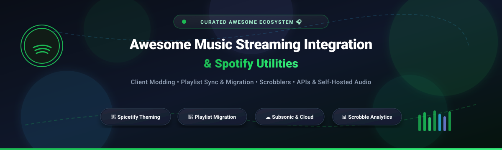
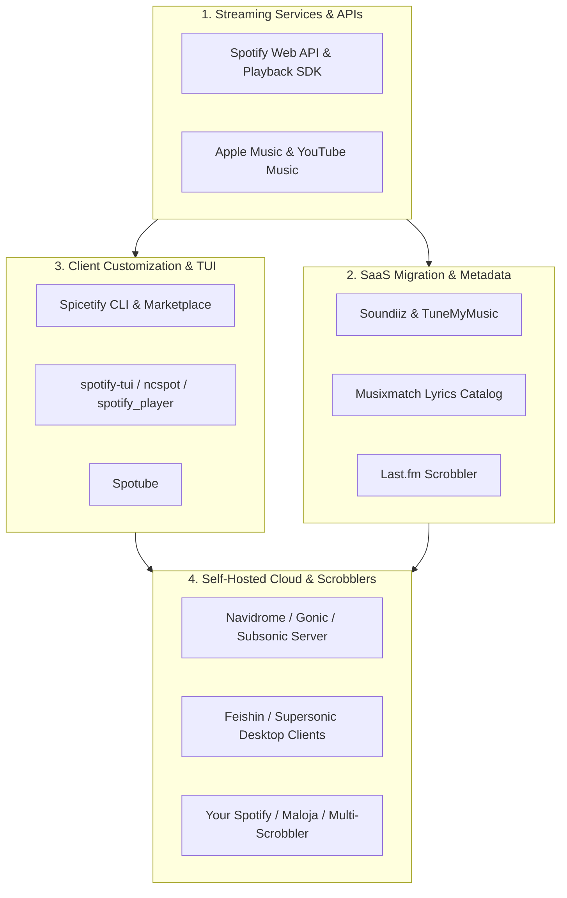

# Awesome-Music-Streaming-Integration-Spotify-Utilities 🎧

  

  
  
  
  
  
  
  

> 🎵 A curated directory of top SaaS platforms, developer Web APIs, open-source clients, terminal players, and power utilities for music streaming services, Spotify client theming, playlist synchronization, scrobbling, and self-hosted audio clouds.

**Last updated: November 2026** 📅

---

## 📑 Table of Contents

- [🌟 Overview](#-overview)
- [📈 Sector Overview & Market Dynamics](#-sector-overview--market-dynamics)
- [☁️ SaaS & Hosted Platforms](#️-saas--hosted-platforms)
- [💻 Open-Source GitHub Projects](#-open-source-github-projects)
- [🏗️ Category Architecture & Best Practices](#️-category-architecture--best-practices)
- [🤝 How to Contribute](#-how-to-contribute)
- [💖 Support](#-support)
- [📊 Star History](#-star-history)
- [⚠️ Disclaimer](#️-disclaimer)

---

## 🌟 Overview

The **Music Streaming Integration & Spotify Utilities** ecosystem empowers music lovers 🎧, audiophiles 🎼, playlist curators 📋, and developers 💻 to extend their listening experience beyond standard proprietary interfaces. Whether you want to customize your desktop Spotify client with modular CSS themes, synchronize large music playlists between Apple Music and Spotify, collect scrobble metrics with self-hosted databases, or stream high-fidelity local libraries using Subsonic-compatible servers, this curated directory highlights the leading cloud tools and open-source software solutions.

---

## 📈 Sector Overview & Market Dynamics

The global music streaming market is estimated at **$24 billion to $38 billion USD** 💰 (projected to reach over $100 billion by 2032 at an estimated 8%–14% CAGR 📊). The sector exhibits a **highly concentrated (oligopoly) structure at the consumer distribution layer**, dominated by a handful of tech giants (Spotify, Apple Music, YouTube Music / Google, and Amazon Music) who control streaming distribution and licensing agreements. 

Conversely, the surrounding **integration, utility, and tooling layer is moderately to highly fragmented** 🧩. While core digital service providers (DSPs) capture consumer streaming time, an expansive, diverse ecosystem of independent SaaS platforms, third-party companion tools, niche playlist migrators, and developer-built open-source clients thrives in the long tail. These utilities fill product feature gaps by providing cross-service library mobility, modular UI theming, decentralized scrobbling, and self-hosted music cloud integrations.

---

## ☁️ SaaS & Hosted Platforms

Below is a curated comparison of leading SaaS platforms and hosted cloud services for music integration, analytics, lyrics synchronization, and playlist migration, ranked in descending order by company scale (market capitalization, enterprise valuation, or estimated annual revenue) 🏆.

| Platform | Valuation / Revenue Scale 💵 | Pricing Model 🏷️ | Free Tier Limits / Trial Limits ⏱️ | Key Capabilities & Highlights 🚀 |
| :--- | :--- | :--- | :--- | :--- |
| **[Spotify for Developers](https://developer.spotify.com/)** | **~$120 Billion Valuation** (Public: NYSE: SPOT; ~$19.4B–$21.8B annual revenue) | Free API Access / Commercial Licenses | Free access for non-commercial apps; limited to 25 registered test users in Development Mode prior to quota extension review | Official REST API, Web Playback SDK, and OAuth 2.0 engine powering third-party music apps, playlist automation, and audio analysis endpoints. |
| **[Musixmatch](https://www.musixmatch.com/)** | **~$350 Million – $400 Million Valuation** (TPG Growth majority stake; ~$50M–$100M estimated revenue) | B2B API Enterprise Licensing / Pro plan at $3.99/mo | Free mobile/web lyrics search and sync preview; API free tier limited to 2,000 daily calls for non-commercial metadata | Global crowdsourced lyrics catalog and time-coded synchronized lyrics API powering Apple Music, Instagram, Spotify, and smart displays. |
| **[Last.fm](https://www.last.fm/)** | **~$280 Million Valuation** (Acquired for $280M by CBS; ~$2.4M ARR; now independent) | Free with Ads / **Last.fm Pro** at $4.99/mo ($49.99/yr) | Free tier forever: unlimited music scrobbling, basic weekly/monthly listening reports, and public user profiles | Pioneer cloud music tracking ("scrobbling") network providing listening-history charts, algorithmic recommendations, and public community metadata. |
| **[TuneMyMusic](https://www.tunemymusic.com/)** | **~$3 Million – $6 Million Est. Valuation** (Bootstrapped; official Spotify import partner) | **$4.50/mo** or **$24.00/yr** ($2.00/mo billed annually) | Free forever: allows transferring up to **500 tracks total** and manual one-time transfers | Web-based playlist migration service featuring continuous automated background syncing across Spotify, TIDAL, YouTube Music, and Apple Music. |
| **[Soundiiz](https://soundiiz.com/)** | **~$2.5 Million – $5 Million Est. Valuation** (Independent SaaS; bootstrapped) | **$4.50/mo** ($36.00/yr) / Creator tier at $9.50/mo | Free forever: capped at **200 tracks per playlist**, 1 playlist transfer at a time, and 1 automated sync slot | Cross-platform cloud playlist manager bridging 40+ music streaming platforms, supporting track matching, playlist splits, and CSV/JSON backups. |
| **[SongShift](https://www.songshift.com/)** | **~$2 Million – $4 Million Est. Valuation** (Independent iOS/macOS utility) | **$6.99/mo**, **$29.99/yr**, or **$59.99 lifetime** | Free forever: unlimited track transfers per playlist, capped at 2 connected music accounts simultaneously with manual shift speed | Native iOS and cloud-assisted music library migration app with intelligent song matching, duplicate detection, and batch library shifts. |
| **[Stats.fm (Spotistats)](https://stats.fm/)** | **~$1.5 Million – $3 Million Est. Valuation** (StatsFM B.V.; millions of registered users) | Freemium / **Stats.fm Plus** at $5.99 – $12.99 lifetime (or ~$2.99/mo) | Free forever: top 50 tracks/artists over default 4-week periods; lifetime history ingestion and advanced charts require Plus | Deep Spotify listening analytics platform importing full lifetime GDPR streaming logs for exact minutes listened, stream counts, and hourly trends. |
| **[Setify](https://setify.co/)** | **<$1 Million Valuation** (Indie music utility) | **Free** (Ad-supported / optional tip jar) | Free forever: unrestricted setlist search and conversion into playlists across connected Spotify and Apple Music accounts | Web and mobile tool converting real-world concert setlists from Setlist.fm into instant, playable Spotify or Apple Music playlists. |
| **[Playlist Converter](https://playlist-converter.net/)** | **<$1 Million Valuation** (Indie web app) | **Free** (Ad-supported) | Free forever: conversion limited to web session buffers (up to 1,000 tracks per export/import session) | Quick browser-based utility converting music playlist formats between Spotify, YouTube, Deezer, CSV, TXT, and M3U files without account lock-in. |
| **[Receiptify & Obscurify](https://receiptify.herokuapp.com/)** | **<$1 Million Valuation** (Viral indie micro-apps) | **Free** (Ad/tip supported) | Free forever: unlimited receipt generations (top tracks by month/semester/all-time) and obscurity score ratings | Viral music visualization web apps generating stylized receipt graphics and obscurity ratings based on Spotify Web API listening metrics. |

---

## 💻 Open-Source GitHub Projects

Explore the most popular open-source repositories, developer SDKs, terminal players, and self-hosted music servers in the Spotify and music streaming ecosystem. Repositories are ranked in descending order by GitHub stargazer count ⭐.

| Project & Repository | Stars ⭐ | Description & Architecture Highlights 🛠️ |
| :--- | :---: | :--- |
| **[Spotube](https://github.com/KRTirtho/spotube)** |  | Cross-platform, lightweight desktop & mobile client built with Flutter combining Spotify's metadata and playlist APIs with YouTube/Piped playback streams without Spotify Premium. |
| **[spotDL (Spotify Downloader)](https://github.com/spotDL/spotify-downloader)** |  | Fast Python CLI utility that finds songs from Spotify playlists, albums, and tracks on YouTube Music and embeds accurate metadata, synced lyrics, and high-res album art. |
| **[Spicetify CLI](https://github.com/spicetify/cli)** |  | The standard-setting CLI tool to customize the official Spotify desktop client with CSS themes, custom apps, lyrics displays, extensions, and marketplace add-ons. |
| **[Navidrome](https://github.com/navidrome/navidrome)** |  | Modern, blazing-fast personal music streaming server written in Go, fully compatible with Subsonic and OpenSubsonic APIs for web and mobile streaming. |
| **[spotify-tui](https://github.com/Rigellute/spotify-tui)** |  | Elegant terminal user interface for Spotify written in Rust, powered by the Spotify Web API and Spotify Connect daemon integration. |
| **[Beets](https://github.com/beetbox/beets)** |  | The definitive command-line music library manager and metadata tagger, integrating with MusicBrainz, Discogs, and Spotify for automated library cataloging. |
| **[SpotiFlyer](https://github.com/Shabinder/SpotiFlyer)** |  | Multiplatform Kotlin application for downloading tracks, albums, and playlists from Spotify, Gaana, YouTube Music, and SoundCloud with embedded ID3 tags. |
| **[Feishin](https://github.com/jeffvli/feishin)** |  | Beautiful, full-featured desktop music player client for Navidrome, Jellyfin, and Subsonic servers featuring a modern Spotify-like user interface. |
| **[librespot](https://github.com/librespot-org/librespot)** |  | Foundational open-source client library for Spotify written in Rust, powering headless Spotify Connect speakers, embedded Linux sound devices, and custom clients. |
| **[spotify_player](https://github.com/aome510/spotify-player)** |  | Fast terminal Spotify player written in Rust with built-in streaming (`librespot`), synchronized lyrics, fuzzy search, keybindings, and low memory usage. |
| **[ncspot](https://github.com/hrkfdn/ncspot)** |  | Cross-platform ncurses-based Spotify CLI client written in Rust, designed for resource-constrained environments with Vim-inspired navigation. |
| **[Spotipy](https://github.com/spotipy-dev/spotipy)** |  | Lightweight and comprehensive Python client library for the Spotify Web API, supporting full OAuth authentication, playback control, and playlist manipulation. |
| **[Raspotify](https://github.com/dtcooper/raspotify)** |  | Turnkey Spotify Connect daemon for Debian, Ubuntu, and Raspberry Pi OS, transforming single-board computers into networked Spotify Hi-Fi receivers. |
| **[Your Spotify](https://github.com/Yooooomi/your_spotify)** |  | Self-hosted Spotify tracking dashboard and privacy-focused alternative to Stats.fm, collecting listening data into MongoDB with rich analytical graphs. |
| **[LRCGET](https://github.com/tranxuanthang/lrcget)** |  | Cross-platform desktop utility for bulk-downloading synchronized `.lrc` lyrics for local music libraries and offline audio files using LRCLIB. |
| **[SpotMenu](https://github.com/kmikiy/SpotMenu)** |  | Sleek macOS menu bar application providing current track display, album artwork, and playback controls for both Spotify and Apple Music. |
| **[Gonic](https://github.com/sentriz/gonic)** |  | Lightweight personal music streaming server written in Go implementing the Subsonic API with on-the-fly audio transcoding and podcast support. |
| **[Supersonic](https://github.com/dweymouth/supersonic)** |  | Lightweight, feature-packed desktop client for Subsonic music servers written in Go and Fyne, emphasizing snappy performance and native integration. |
| **[spotify-github-profile](https://github.com/kittinan/spotify-github-profile)** |  | Dynamic SVG generator connecting to the Spotify Web API to showcase currently playing songs or recent top tracks directly on your GitHub profile README. |
| **[Swing Music](https://github.com/swingmx/swingmusic)** |  | Beautiful, self-hosted web music player and local streaming server featuring a polished Spotify-inspired UI, infinite scrolling, and automated artist bio fetching. |
| **[spotify-dl](https://github.com/SathyaBhat/spotify-dl)** |  | Node.js command-line application that downloads songs and playlists from Spotify by retrieving high-quality matching audio from YouTube. |
| **[Maloja](https://github.com/krateng/maloja)** |  | Self-hosted personal music scrobble server and listening history database with clean web visualizations, native API integrations, and zero telemetry. |
| **[Spicetify Marketplace](https://github.com/spicetify/marketplace)** |  | In-app visual app store and extension manager for Spicetify, letting users install community themes, custom CSS, and snippets with a single click. |
| **[Multi-Scrobbler](https://github.com/FoxxMD/multi-scrobbler)** |  | Versatile self-hosted hub that syncs scrobbles from Spotify, Jellyfin, Plex, Subsonic, and Deezer directly into Last.fm, ListenBrainz, and Maloja. |
| **[ListenBrainz Server](https://github.com/metabrainz/listenbrainz-server)** |  | Open-source server implementation of the ListenBrainz music tracking and recommendation platform, maintained by the MetaBrainz Foundation. |
| **[Rspotify](https://github.com/ramsayleung/rspotify)** |  | Robust and high-performance Rust library providing complete, async-ready bindings for the Spotify Web API with automated token refreshment. |
| **[SyncedLyrics](https://github.com/moehmeni/syncedlyrics)** |  | Python library and CLI to scrape and download synchronized `.lrc` lyrics from providers like LRCLIB, Musixmatch, NetEase, and Deezer. |
| **[MxLRC](https://github.com/fashni/MxLRC)** |  | Node.js utility and CLI tool to search Musixmatch and extract synchronized timestamped `.lrc` lyrics for music libraries. |

---

## 🏗️ Category Architecture & Best Practices

### 🎛️ Modular Setup Recipes
- **Client Modding**: Combine **Spotify Desktop** + **[Spicetify CLI](https://github.com/spicetify/cli)** + **[Spicetify Marketplace](https://github.com/spicetify/marketplace)** to install custom themes, adblockers, and full-screen synced lyrics.
- **Terminal Audiophile**: Pair **[librespot](https://github.com/librespot-org/librespot)** with **[spotify_player](https://github.com/aome510/spotify-player)** or **[ncspot](https://github.com/hrkfdn/ncspot)** for an ultra-lightweight CLI streaming rig on Linux or macOS.
- **Sovereign Music Cloud**: Deploy **[Navidrome](https://github.com/navidrome/navidrome)** on Docker, pair it with **[Feishin](https://github.com/jeffvli/feishin)** on the desktop, and bridge your playback history to **[Your Spotify](https://github.com/Yooooomi/your_spotify)** and **[Multi-Scrobbler](https://github.com/FoxxMD/multi-scrobbler)**.
- **Playlist Migration**: Use **[TuneMyMusic](https://www.tunemymusic.com/)** or **[Soundiiz](https://soundiiz.com/)** to transfer playlists across ecosystems, or utilize **[spotDL](https://github.com/spotDL/spotify-downloader)** for automated track and metadata archiving.

---

## 🤝 How to Contribute

Contributions are always welcome! 🚀 Please follow these guidelines:

1. **Fork the repository** and clone your fork locally.
2. **Add or update an entry** in `README.md`:
   - For SaaS products: include Name, Link, Valuation/Revenue Scale, Starting Price, and Free Tier limits.
   - For Open-Source projects: include Name, Repository Link, the Stargazer Badge linked to stargazers (`https://img.shields.io/github/stars/owner/repo?style=social&color=white`), and a concise technical description.
3. **Sort tables appropriately** (SaaS by valuation/revenue descending; Open Source by star count descending).
4. **Submit a pull request** describing your addition.

---

## 💖 Support

A massive **thank you** 🙏 to everyone exploring, building with, and contributing to this ecosystem!

If you find this repository helpful or inspiring, please consider:
- ⭐ **Starring** the repository on GitHub to help others discover it.
- 🍴 **Forking** it to craft your own custom setups or contribute additions.
- 📢 **Sharing** with fellow audiophiles, developers, and music enthusiasts.
- ☕ **Buying a coffee / sponsoring** the maintainer via the [GitHub Sponsor Dashboard](https://github.com/sponsors/ishandutta2007) to support ongoing curation and tool development!

---

## 📊 Star History

#

---

## ⚠️ Disclaimer

- This is an independent, community-curated directory — it is not officially affiliated with, maintained by, or endorsed by Spotify AB, Apple Inc., Google LLC, or any referenced company.
- Third-party Spotify client libraries (`librespot`, `ncspot`, `spotify_player`) require an active Spotify Premium account and interact with internal endpoints. Always review Spotify's Developer Terms and User Agreement when creating or deploying third-party integrations.

---

  <b>Made with ❤️ for music enthusiasts, audiophiles, API developers, and self-hosters.</b>

